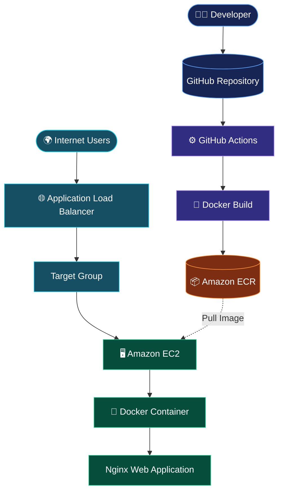

 <div align="center">

# 🚀 Docker CI/CD on AWS

### Automated Docker Image Build & Push with GitHub Actions and Amazon ECR


<br/>


<br/><br/>

**A hands-on DevOps project demonstrating container image delivery and application hosting on AWS.**

[Repository](https://github.com/sabo1166/Amazon-ECR-using-GitHub-Actions) · [Workflow](.github/workflows/docker-ecr.yml)

</div>

---

## 🧭 Project Overview

This project implements a Docker-based CI/CD workflow using GitHub Actions and AWS services.

The application is packaged into a Docker image, automatically built by GitHub Actions, and published to a private Amazon ECR repository.

An Amazon EC2 instance retrieves the published image and runs the application inside a Docker container. An Application Load Balancer provides the public entry point.

### 🎯 Main Objectives

- Build and package an application using Docker.
- Automate image builds using GitHub Actions.
- Push versioned images to Amazon ECR.
- Configure IAM permissions for secure AWS access.
- Pull and run private container images on EC2.
- Expose the application through an Application Load Balancer.
- Understand the complete container image delivery lifecycle.

---

## 🏗️ Cloud Architecture

<div align="center">



</div>

### 🔄 Workflow Sequence

| Step | Operation | AWS / DevOps Service |
|---:|---|---|
| 01 | Developer pushes source code | GitHub |
| 02 | Workflow starts automatically | GitHub Actions |
| 03 | Docker image is built | Docker Buildx |
| 04 | AWS authentication | IAM Credentials |
| 05 | Image is published | Amazon ECR |
| 06 | EC2 authenticates with ECR | EC2 IAM Role |
| 07 | EC2 pulls the image | Docker |
| 08 | Application starts | Nginx Container |
| 09 | Users access the application | Application Load Balancer |

---

## 🧰 Technology Stack

<div align="center">

| Technology | Purpose |
|---|---|
|  | Cloud Infrastructure |
|  | Containerization |
|  | CI Automation |
|  | Container Registry |
|  | Compute |
|  | Web Server |
|  | Operating System |
|  | Workflow Configuration |

</div>

---

## 📁 Repository Structure

```text
Amazon-ECR-using-GitHub-Actions/
│
├── .github/
│   └── workflows/
│       └── docker-ecr.yml
│
├── app/
│   └── index.html
│
├── .dockerignore
├── Dockerfile
└── README.md
```

---

## 🐳 1. Docker Image Configuration

The application uses the official lightweight Nginx Alpine image.

### Dockerfile

```dockerfile
FROM nginx:alpine

LABEL project="docker-ecr-cicd"
LABEL application="nginx-web"

COPY app/index.html /usr/share/nginx/html/index.html

EXPOSE 80

CMD ["nginx", "-g", "daemon off;"]
```

### Build the Image

```bash
docker build -t nginx-web:1.0 .
```

### Run Locally

```bash
docker run -d \
  --name nginx-test \
  -p 8085:80 \
  nginx-web:1.0
```

### Test

```bash
curl -I http://localhost:8085
```

Expected:

```text
HTTP/1.1 200 OK
```

---

## ⚙️ 2. GitHub Actions CI Pipeline

Workflow:

`.github/workflows/docker-ecr.yml`

### Pipeline Responsibilities

- Checkout the repository.
- Configure AWS credentials.
- Authenticate with Amazon ECR.
- Set up Docker Buildx.
- Build the Docker image.
- Push the image to ECR.

### Workflow Triggers

```yaml
on:
  push:
    branches:
      - main
    paths:
      - "app/**"
      - "Dockerfile"
      - ".dockerignore"
      - ".github/workflows/docker-ecr.yml"

  workflow_dispatch:
```

### Image Tagging Strategy

Two tags are published:

```text
nginx-web:<GITHUB_SHA>
nginx-web:latest
```

**Why use a commit SHA?**

A commit-based image tag helps identify the exact source revision used to build an image. The `latest` tag provides a convenient reference to the newest published image.

### GitHub Secrets

Configure the following under:

`Settings → Secrets and variables → Actions`

| Secret / Variable | Description |
|---|---|
| `AWS_ACCESS_KEY_ID` | IAM Access Key ID |
| `AWS_SECRET_ACCESS_KEY` | IAM Secret Access Key |
| `AWS_REGION` | `us-east-1` (Repository Variable) |

> Never commit AWS credentials to GitHub.

---

## ☁️ 3. Amazon ECR Configuration

Amazon ECR stores the private Docker images.

| Configuration | Value |
|---|---|
| Repository | `nginx-web` |
| Region | `us-east-1` |
| Account | `966299413569` |
| Repository Type | Private |

### Repository URI

```text
966299413569.dkr.ecr.us-east-1.amazonaws.com/nginx-web
```

### IAM Permissions

GitHub Actions requires ECR authentication and image publishing permissions.

The EC2 instance uses the managed IAM policy:

```text
AmazonEC2ContainerRegistryReadOnly
```

This allows EC2 to authenticate and retrieve images without embedding AWS credentials on the server.

---

## 🖥️ 4. EC2 Docker Deployment

**Instance Environment**

- Amazon Linux 2023
- Docker Engine
- AWS CLI
- IAM Instance Role
- Nginx Container

### Install Docker

```bash
sudo dnf update -y

sudo dnf install docker -y

sudo systemctl enable --now docker
```

Verify:

```bash
docker --version

sudo systemctl status docker --no-pager
```

### Verify EC2 IAM Identity

```bash
aws sts get-caller-identity
```

The returned identity should show the EC2 assumed role.

### Authenticate with ECR

```bash
aws ecr get-login-password \
  --region us-east-1 \
  | docker login \
      --username AWS \
      --password-stdin \
      966299413569.dkr.ecr.us-east-1.amazonaws.com
```

### Pull the Image

```bash
docker pull \
  966299413569.dkr.ecr.us-east-1.amazonaws.com/nginx-web:latest
```

### Run the Container

```bash
docker run -d \
  --name nginx-web \
  --restart unless-stopped \
  -p 80:80 \
  966299413569.dkr.ecr.us-east-1.amazonaws.com/nginx-web:latest
```

### Verify Deployment

```bash
docker ps

curl -I http://localhost
```

Expected response:

```text
HTTP/1.1 200 OK
Server: nginx
```

---

## 🌐 5. Application Load Balancer

The Application Load Balancer provides the public HTTP entry point.

### Configuration

| Setting | Value |
|---|---|
| Type | Application Load Balancer |
| Scheme | Internet-facing |
| Listener | HTTP :80 |
| Target Type | Instances |
| Target Port | 80 |
| Health Check Protocol | HTTP |
| Health Check Path | `/` |
| Success Code | `200` |

### Security Group Design

**ALB Security Group**

| Type | Port | Source |
|---|---:|---|
| HTTP | 80 | `0.0.0.0/0` |

**EC2 Security Group**

| Type | Port | Source |
|---|---:|---|
| HTTP | 80 | ALB Security Group |
| SSH | 22 | Trusted IP Address |

The EC2 application port should accept traffic from the ALB security group, not directly from the entire internet.

### Traffic Flow

```text
Internet
   |
   v
Application Load Balancer
   |
   v
HTTP Listener :80
   |
   v
Target Group
   |
   v
EC2 Instance :80
   |
   v
Docker Container :80
   |
   v
Nginx Application
```

---

## 🔐 6. Security Best Practices

| Security Area | Implementation |
|---|---|
| AWS Authentication | GitHub Secrets for CI credentials |
| EC2 Authentication | IAM Instance Role |
| ECR Permissions | Repository-scoped push permissions |
| Image Storage | Private ECR Repository |
| Network Access | ALB-to-EC2 security group restriction |
| SSH | Restrict access to trusted IP addresses |

**Production improvements:**

- Replace long-lived GitHub access keys with GitHub OIDC.
- Enable ECR vulnerability scanning.
- Use HTTPS with AWS Certificate Manager.
- Add automated rollback and deployment monitoring.
- Store application secrets in AWS Secrets Manager.

---

## 🧪 7. Verification Results

The following operations were successfully verified during the project implementation.

| Test | Result |
|---|---|
| Local Docker image build | ✅ Successful |
| Local Nginx container | ✅ Running |
| GitHub Actions image build | ✅ Successful |
| ECR image publishing | ✅ Successful |
| EC2 IAM Role authentication | ✅ Successful |
| EC2 ECR authentication | ✅ Successful |
| Image pull from ECR | ✅ Successful |
| EC2 Docker container | ✅ Running |
| Local EC2 HTTP response | ✅ HTTP 200 |
| ALB Target Group | ✅ Healthy |

### Published Image

```text
Repository:
nginx-web

Tags:
latest
dcf5084f1d368ca60bfb8aa7acb98fb17b0b0e17
```

---

## 🛠️ 8. Troubleshooting Guide

### Container Not Running

```bash
docker ps -a
docker logs nginx-web
```

### ECR Authentication Failure

```bash
aws sts get-caller-identity
```

Verify the EC2 IAM Role has ECR read permissions.

### Application Not Responding

```bash
curl -I http://localhost

docker ps

docker logs nginx-web
```

### ALB Target Unhealthy

Verify:

1. Target Group port is `80`.
2. Health check path is `/`.
3. Nginx returns HTTP 200.
4. EC2 security group allows inbound HTTP from the ALB security group.
5. ALB listener forwards to the correct Target Group.

---

## 🚀 9. Future Improvements

- [ ] Automate EC2 deployment after a successful ECR push.
- [ ] Implement GitHub OIDC authentication.
- [ ] Configure HTTPS with ACM.
- [ ] Add CloudWatch monitoring and logs.
- [ ] Add automated deployment rollback.
- [ ] Implement image vulnerability scanning.
- [ ] Provision infrastructure using Terraform.
- [ ] Introduce Auto Scaling for multiple EC2 instances.

---

## 📌 Current Automation Scope

**Automated CI:**

```text
GitHub Push
    |
    v
GitHub Actions
    |
    v
Docker Build
    |
    v
Amazon ECR Push
```

**Deployment to EC2:**

```text
Amazon ECR
    |
    v
EC2 IAM Role
    |
    v
Docker Pull
    |
    v
Container Run
    |
    v
Application Load Balancer
```

> **Important:** Image building and publishing are automated through GitHub Actions. Pulling the image and starting the container on EC2 are currently manual deployment steps. Automated EC2 deployment is a planned improvement.

---

## 👨‍💻 Author

<div align="center">

### Mohammed Gamal Al Jaafari

**Cloud Engineering | AWS | Docker | CI/CD | Infrastructure**

[](https://github.com/sabo1166)

[](https://github.com/sabo1166/Amazon-ECR-using-GitHub-Actions)

</div>

---

<div align="center">

**Built to learn. Tested on AWS. Delivered with Docker.**

⭐ If you find this project useful, consider giving the repository a star.

</div>
